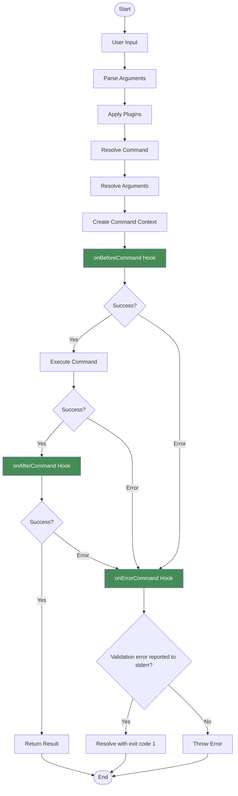
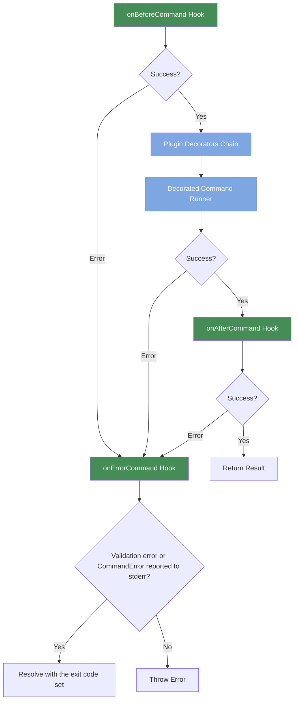

# Command Hooks

Gunshi provides powerful lifecycle hooks that allow you to intercept and control command execution at various stages.

These hooks enable advanced scenarios like logging, monitoring, validation, and error handling.

## Understanding Command Lifecycle

The command execution lifecycle in Gunshi follows these stages:



## Available Hooks

Gunshi provides three main lifecycle hooks:

- **`onBeforeCommand`**: Executes before the command runs
- **`onAfterCommand`**: Executes after successful command completion
- **`onErrorCommand`**: Executes when a command throws an error

Argument validation failures are also treated as command errors. Gunshi prints the validation
error message to stderr and sets the exit code to `1`, then calls `onErrorCommand`, and the
`cli()` promise resolves. See [Handling Argument Validation Errors](#handling-argument-validation-errors).

So does a `CommandError` that a command throws for a failure it expects, with the exit code of the
error. See [Handling Expected Failures](#handling-expected-failures).

## Basic Hook Usage

### Setting Up Hooks

The following example demonstrates how to configure lifecycle hooks when initializing your CLI application.

In this setup, we define three hooks that will execute at different stages of the command lifecycle:

```ts [cli.ts]
import { cli, define } from 'gunshi'

const command = define({
  name: 'server',
  run: () => {
    console.log('Starting server...')
  }
})

await cli(process.argv.slice(2), command, {
  name: 'my-app',
  version: '1.0.0',

  // Define lifecycle hooks
  onBeforeCommand: ctx => {
    console.log(`About to run: ${ctx.name}`)
  },

  onAfterCommand: (ctx, result) => {
    console.log(`Command ${ctx.name} completed successfully`)
  },

  onErrorCommand: (ctx, error) => {
    console.error(`Command ${ctx.name} failed:`, error)
  }
})
```

<!-- eslint-disable markdown/no-missing-label-refs -->

> [!TIP]
> The example fully code is [here](https://github.com/kazupon/gunshi/tree/main/playground/advanced/command-hooks).

<!-- eslint-enable markdown/no-missing-label-refs -->

### Hook Parameters

Each lifecycle hook receives specific parameters that provide context about the command execution.

The `CommandContext` parameter is read-only and contains all command metadata, while `onAfterCommand` also receives the command result and `onErrorCommand` receives the thrown error:

<!-- eslint-skip -->

```ts
{
  // Before command execution
  onBeforeCommand?: (ctx: Readonly<CommandContext>) => Awaitable<void>

  // After successful execution
  onAfterCommand?: (ctx: Readonly<CommandContext>, result: string | undefined) => Awaitable<void>

  // On command error
  onErrorCommand?: (ctx: Readonly<CommandContext>, error: Error) => Awaitable<void>
}
```

<!-- eslint-disable markdown/no-missing-label-refs -->

> [!NOTE]
> The `CommandContext` object provides comprehensive information about command execution. For the complete CommandContext API reference including all properties and types, see the [CommandContext interface documentation](/api/default/interfaces/CommandContext.md).

<!-- eslint-enable markdown/no-missing-label-refs -->

`onAfterCommand` receives the result only when the command returns a string. The result of a command that prints JSON with `--json` is printed, not passed: the hook receives `undefined`.

### Hooks and `--json`

When a command that spreads `jsonArgs` is asked for JSON with `--json`, stdout must have the JSON only, so the hooks must not print to stdout or stderr. Print with `ctx.log`, which Gunshi silences then (see [JSON Output](../essentials/json-output.md)).

When `--json` is given to a command that does not spread `jsonArgs`, the hooks still run: Gunshi stops the command with `json_not_supported` in the command decorators, after `onBeforeCommand`. `ctx.values.json` is not set then, and `ctx.log` is not silenced.

With an understanding of how hooks work and their parameters, let's explore how they differ from and interact with plugin decorators.

### Handling Argument Validation Errors

When argument validation fails, Gunshi prints the validation error message to stderr, followed by
the command that shows the help (see [Argument Errors](../essentials/errors.md#argument-errors)),
sets the exit code to `1`, and calls `onErrorCommand`. The `cli()` promise then resolves, so a plain
`await cli(...)` ends with the message and exit code `1`, without a stack trace.

In `onErrorCommand`, you can detect this case with `ctx.validationError`, for example to use
another exit code:

```ts
import { cli, define } from 'gunshi'

const command = define({
  name: 'deploy',
  args: {
    id: {
      type: 'string',
      required: true
    }
  },
  run: ctx => {
    console.log(`Deploying ${ctx.values.id}`)
  }
})

await cli(process.argv.slice(2), command, {
  onErrorCommand: (ctx, error) => {
    if (ctx.validationError === error) {
      process.exitCode = 2
    }
  }
})
```

To report the validation errors yourself, set `renderValidationErrors` to `null`. Gunshi then
prints nothing and leaves the exit code alone, and the `cli()` promise rejects with the
`AggregateError` that holds the errors:

```ts
try {
  await cli(process.argv.slice(2), command, { renderValidationErrors: null })
} catch (error) {
  if (!(error instanceof AggregateError)) {
    throw error
  }
  for (const validationError of error.errors) {
    console.error(`error: ${validationError.message}`)
  }
  process.exitCode = 2
}
```

A renderer that returns an empty message, and `usageSilent: true`, leave the validation errors
to you in the same way.

### Handling Expected Failures

When a command throws a `CommandError` for a failure that it expects, Gunshi prints the message of
the error to stderr, without a stack trace, and sets the exit code to the `exitCode` of the error.
It then calls `onErrorCommand` with the error, and the `cli()` promise resolves.

The hook can change the exit code, and tell the error with `isCommandError()`:

```ts
import { cli, CommandError, define, isCommandError } from 'gunshi'

const command = define({
  name: 'show',
  args: {
    project: {
      type: 'positional'
    }
  },
  run: ctx => {
    throw new CommandError(`Project ${ctx.values.project} not found`, { code: 'not_found' })
  }
})

await cli(process.argv.slice(2), command, {
  onErrorCommand: (ctx, error) => {
    if (isCommandError(error) && error.code === 'not_found') {
      process.exitCode = 3
    }
  }
})
```

Gunshi prints a `CommandError` thrown from the command, or from a command decorator of a plugin.
It does not print one thrown from a hook: the hooks run outside the command, and the `cli()`
promise rejects with the error. To stop a command from running, such as when the user has not
logged in, check it in a command decorator (see [Validation and Guards](#validation-and-guards)).

With `usageSilent: true`, Gunshi prints nothing, leaves the exit code alone, and the `cli()`
promise rejects with the `CommandError`. For more, see [Errors and Exit Codes](../essentials/errors.md).

## Hooks vs Decorators

Gunshi provides two distinct mechanisms for controlling command execution:

1. **CLI-level Hooks**: Lifecycle hooks that run **before and after** command execution
   - `onBeforeCommand`: Pre-execution processing (logging, validation, initialization)
   - `onAfterCommand`: Post-success processing (cleanup, metrics recording)
   - `onErrorCommand`: Error handling (error logging, rollback)

2. **Plugin Decorators**: **Wrap** the command itself to modify its behavior
   - `decorateCommand`: Wraps command runner to add or modify functionality
   - Multiple plugins can chain decorators (decorator pattern)

<!-- eslint-disable markdown/no-missing-label-refs -->

> [!TIP]
> The `decorateCommand` method is a powerful plugin API that allows wrapping command execution to add or modify functionality. It enables plugins to implement cross-cutting concerns like authentication, logging, and transaction management. For comprehensive information about how to use decorators in plugins, see the [Plugin Decorators documentation](/guide/plugin/decorators.md).

<!-- eslint-enable markdown/no-missing-label-refs -->

### Execution Flow

The following diagram illustrates how hooks and decorators interact during command execution:



### Detailed Execution Sequence

1. **`onBeforeCommand` Hook** - Pre-execution setup and validation
2. **Plugin Decorator Chain** - Command wrapping by plugins
   - Applied in reverse order (LIFO - last registered, first executed)
   - Each decorator wraps the next runner in the chain
3. **Command Runner** - Actual command execution
4. **`onAfterCommand` Hook** - Post-success processing
5. **`onErrorCommand` Hook** - Error handling when exceptions occur

### Plugin Decorator Example

The following example demonstrates how to use the `decorateCommand` method in a plugin to measure command execution time:

```ts
import { plugin } from 'gunshi/plugin'

// Using decorateCommand in a plugin
export default plugin({
  id: 'timing-plugin',
  setup: ctx => {
    // Wrap command execution to measure execution time
    ctx.decorateCommand(baseRunner => {
      return async commandCtx => {
        const start = Date.now()
        try {
          const result = await baseRunner(commandCtx)
          commandCtx.log(`Execution time: ${Date.now() - start}ms`)
          return result
        } catch (error) {
          commandCtx.log(`Failed after: ${Date.now() - start}ms`)
          throw error
        }
      }
    })
  }
})
```

The decorator prints with `commandCtx.log`, not with `console.log`, so that it prints nothing when the command prints JSON with `--json`, and it returns the result of the command as it is.

<!-- eslint-disable markdown/no-missing-label-refs -->

> [!NOTE]
> Plugins don't have CLI-level hooks (`onBeforeCommand`, etc.). Instead, they use the `decorateCommand` method to wrap command execution and add custom logic. This allows plugins to extend and modify command behavior through the decorator pattern.

<!-- eslint-enable markdown/no-missing-label-refs -->

## Practical Use Cases

<!-- eslint-disable markdown/no-missing-label-refs -->

> [!TIP]
> The following examples use plugin extensions through `ctx.extensions`. Extensions are how plugins add functionality to the command context, allowing you to access plugin-provided features like logging, metrics, authentication, and database connections. For comprehensive information about working with extensions, including type-safe patterns and best practices, see the [Context Extensions documentation](./context-extensions.md).

<!-- eslint-enable markdown/no-missing-label-refs -->

### Logging and Monitoring

Implement comprehensive logging across all commands:

```ts
import { cli } from 'gunshi'
import logger, { pluginId as loggerId } from '@my/plugin-logger'

await cli(process.argv.slice(2), commands, {
  name: 'my-app',

  // Install logger plugin
  plugins: [logger()],

  onBeforeCommand: ctx => {
    const logger = ctx.extensions[loggerId]
    // Log command start with arguments
    logger?.info('Command started', {
      command: ctx.name,
      args: ctx.values,
      timestamp: new Date().toISOString()
    })
  },

  onAfterCommand: (ctx, result) => {
    const logger = ctx.extensions[loggerId]
    // Log successful completion
    logger?.info('Command completed', {
      command: ctx.name,
      duration: Date.now() - logger?.startTime,
      result: typeof result
    })
  },

  onErrorCommand: (ctx, error) => {
    const logger = ctx.extensions[loggerId]
    // Log errors with full context
    logger?.error('Command failed', {
      command: ctx.name,
      error: error.message,
      stack: error.stack,
      args: ctx.values
    })
  }
})
```

### Performance Monitoring

Track command execution times and performance metrics:

```ts
import { cli } from 'gunshi'
import metrics, { pluginId as metricsId } from '@my/plugin-metrics'

await cli(process.argv.slice(2), commands, {
  name: 'my-app',

  // Install metrics plugin
  plugins: [metrics()],

  onBeforeCommand: ctx => {
    const metrics = ctx.extensions[metricsId]
    // Start tracking command execution
    metrics?.startTracking({
      command: ctx.name,
      args: ctx.values,
      environment: process.env.NODE_ENV
    })
  },

  onAfterCommand: async (ctx, result) => {
    const metrics = ctx.extensions[metricsId]
    // Record successful completion
    const duration = metrics?.endTracking()

    // Send metrics to monitoring service
    await metrics?.send({
      command: ctx.name,
      status: 'success',
      duration,
      memoryUsage: process.memoryUsage(),
      resultSize: result?.length || 0
    })
  },

  onErrorCommand: async (ctx, error) => {
    const metrics = ctx.extensions[metricsId]
    // Record failure metrics
    const duration = metrics?.endTracking()

    // Send error metrics with additional context
    await metrics?.send({
      command: ctx.name,
      status: 'failed',
      duration,
      error: error.message,
      errorType: error.constructor.name,
      stackTrace: error.stack
    })
  }
})
```

### Validation and Guards

To implement access control, check it in a command decorator of a plugin, and throw a `CommandError` to stop the command.

Gunshi prints the message of the error without a stack trace, and the hooks handle the rest:

```ts [auth.ts]
import { CommandError, plugin } from 'gunshi/plugin'
import { readToken, verifyToken } from './token.ts'

export const pluginId = 'my:auth'

export default function auth({ publicCommands }: { publicCommands: string[] }) {
  return plugin({
    id: pluginId,
    setup: ctx => {
      // The decorator runs only when a command runs, so `--help` and `--version` work without login
      ctx.decorateCommand(baseRunner => async commandCtx => {
        // Skip auth for public commands
        if (publicCommands.includes(commandCtx.name ?? '')) {
          return baseRunner(commandCtx)
        }

        // Verify authentication
        const token = await readToken()
        if (!token) {
          throw new CommandError('Authentication required. Please run "login" first.', {
            code: 'auth_required'
          })
        }

        const user = await verifyToken(token)
        if (!user) {
          throw new CommandError('Invalid or expired token. Please login again.', {
            code: 'auth_expired'
          })
        }

        return baseRunner(commandCtx)
      })
    }
  })
}
```

```ts [cli.ts]
import { cli, isCommandError } from 'gunshi'
import audit, { pluginId as auditId } from '@my/plugin-audit'
import auth from './auth.ts'

await cli(process.argv.slice(2), commands, {
  name: 'my-app',

  // Install the auth plugin, and a plugin to record the security events
  plugins: [auth({ publicCommands: ['login'] }), audit()],

  onErrorCommand: async (ctx, error) => {
    // Gunshi has printed the error: record the failures of the authentication
    if (isCommandError(error) && error.code?.startsWith('auth_')) {
      await ctx.extensions[auditId]?.logSecurityEvent({
        type: error.code,
        command: ctx.name,
        timestamp: new Date().toISOString()
      })
    }
  }
})
```

Do not throw the `CommandError` from `onBeforeCommand`: Gunshi does not print an error thrown from a hook, and the `cli()` promise rejects with it, so the user sees a stack trace. The hook also runs for `--help` and `--version`.

### Transaction Management

Implement database transactions or rollback mechanisms:

```ts
import { cli } from 'gunshi'
import database, { pluginId as dbId } from '@my/plugin-database'

await cli(process.argv.slice(2), commands, {
  name: 'my-app',

  // Install database plugin with transaction support
  plugins: [
    database({
      connectionString: process.env.DATABASE_URL,
      transactionalCommands: ['create', 'update', 'delete', 'migrate']
    })
  ],

  onBeforeCommand: async ctx => {
    const db = ctx.extensions[dbId]

    // Start transaction for data-modifying commands
    if (db?.isTransactionalCommand(ctx.name)) {
      const transaction = await db.beginTransaction()

      // Store transaction ID for tracking
      await db?.setCurrentTransaction(transaction.id)

      console.log(`Transaction ${transaction.id} started for command: ${ctx.name}`)
    }
  },

  onAfterCommand: async (ctx, result) => {
    const db = ctx.extensions[dbId]
    const transaction = db?.getCurrentTransaction()

    if (transaction) {
      // Commit on success
      await db.commit(transaction.id)
      console.log(`Transaction ${transaction.id} committed successfully`)

      // Clean up transaction reference
      await db.clearCurrentTransaction()
    }
  },

  onErrorCommand: async (ctx, error) => {
    const db = ctx.extensions[dbId]
    const transaction = db?.getCurrentTransaction()

    if (transaction) {
      // Rollback on error
      await db?.rollback(transaction.id)
      console.error(`Transaction ${transaction.id} rolled back due to error:`, error.message)

      // Log the failed transaction for audit
      await db?.logTransactionFailure({
        id: transaction.id,
        command: ctx.name,
        error: error.message,
        timestamp: new Date().toISOString()
      })

      // Clean up transaction reference
      await db?.clearCurrentTransaction()
    }
  }
})
```

## Hook Execution Order

When multiple hooks and decorators are present, they execute in a specific sequence as shown in the Hooks vs Decorators section above.

Understanding this order is crucial for implementing complex behaviors like transaction management or error recovery.

For detailed execution flow, refer to the execution diagram in the [Hooks vs Decorators](#hooks-vs-decorators) section.
