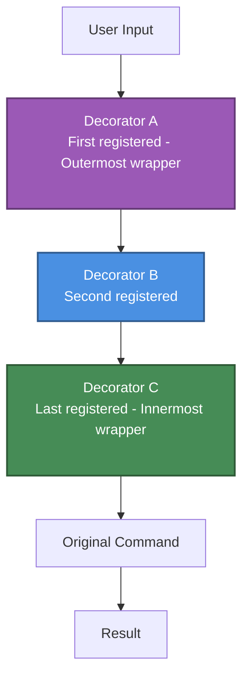
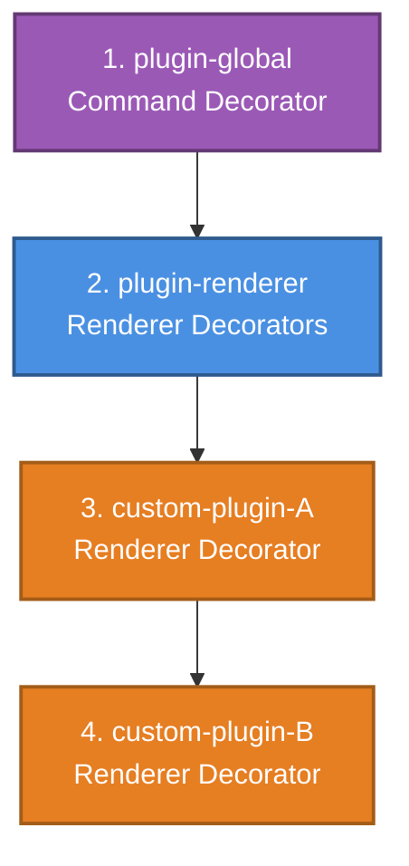
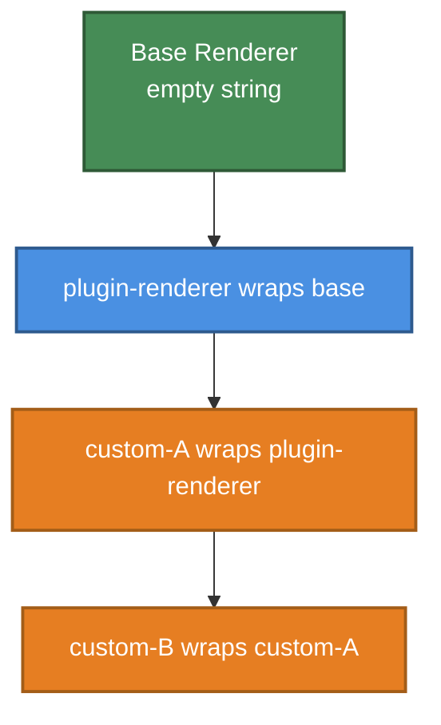

# Plugin Decorators

Decorators are a powerful mechanism in Gunshi's plugin system that allows you to wrap and enhance existing functionality.

This guide explains how to effectively use decorators in your plugins.

## Understanding Decorator Mechanism

In Gunshi, decorators create a wrapping structure around the original functionality.

Gunshi implements two types of decorators with different processing methods:

- **Command Decorators**: Processed using `reduceRight`, creating a nested wrapper structure
- **Renderer Decorators**: Processed using a `for` loop, building a chain of transformations

## Command Decorators

Command decorators wrap command execution for cross-cutting concerns like logging, authentication, and error handling.

Unlike renderer decorators that only affect output formatting, command decorators can control the entire execution flow, including validation, authentication, logging, and error handling.

### How Command Decorators Work

Command decorators use the `decorateCommand()` method provided by the `PluginContext`.

Each decorator receives a runner function (the next decorator or original command) and returns a new function that wraps it:

```js
ctx.decorateCommand(runner => async ctx => {
  // Pre-execution logic
  ctx.log('Before command')

  // Call the next decorator or original command
  const result = await runner(ctx)

  // Post-execution logic
  ctx.log('After command')

  // Return the result as it is
  return result
})
```

A decorator returns what the runner returns, as it is: the result of a command that prints JSON with `--json` must reach Gunshi, or the command fails with `invalid_result`. A decorator prints with `ctx.log`, which Gunshi silences when the command prints JSON, so that stdout has the JSON only (see [JSON Output](../essentials/json-output.md)). A warning for the author of the CLI about a misconfiguration may still go to stderr.

### Command Decorator Execution Order

Gunshi applies command decorators using the `reduceRight` method, which processes the decorator array from the last element to the first.

This approach creates a nested wrapper structure where the first registered decorator becomes the outermost layer.

The following diagram illustrates the wrapper structure:



### Basic Command Decorator Example

The following example demonstrates the execution order when using `reduceRight`. It prints with `console.log` to show the order: a real plugin prints with `ctx.log`, which is silenced with `--json`.

```js [plugin.js]
import { plugin } from 'gunshi/plugin'

export default plugin({
  id: 'my-plugin',
  setup(ctx) {
    // Registered first
    ctx.decorateCommand(runner => async ctx => {
      console.log('Decorator A: before')
      const result = await runner(ctx)
      console.log('Decorator A: after')
      return result
    })

    // Registered second
    ctx.decorateCommand(runner => async ctx => {
      console.log('Decorator B: before')
      const result = await runner(ctx)
      console.log('Decorator B: after')
      return result
    })

    // Registered third (executes first!)
    ctx.decorateCommand(runner => async ctx => {
      console.log('Decorator C: before')
      const result = await runner(ctx)
      console.log('Decorator C: after')
      return result
    })
  }
})
```

Application codes:

```js [cli.js]
import { cli } from 'gunshi'
import lifo from './plugin.js'

await cli(
  process.argv.slice(2),
  () => {
    console.log('Original command execution')
  },
  {
    plugins: [lifo]
  }
)
```

<!-- eslint-disable markdown/no-missing-label-refs -->

> [!TIP]
> The example fully code is [here](https://github.com/kazupon/gunshi/tree/main/playground/plugins/decorators/lifo).

<!-- eslint-enable markdown/no-missing-label-refs -->

When executed, `reduceRight` creates a wrapper structure where Decorator A wraps B, B wraps C, and C wraps the original command:

```sh
node cli.js
Decorator A: before    # Outermost wrapper executes first
Decorator B: before    # Middle wrapper
Decorator C: before    # Innermost wrapper
Original command execution
Decorator C: after     # Innermost completes first
Decorator B: after     # Middle completes
Decorator A: after     # Outermost completes last
```

### Advanced Command Decorator Example

Here's a complete example demonstrating how multiple command decorators work together for different purposes:

```js [plugin.js]
import { plugin } from 'gunshi/plugin'

const sleep = ms => new Promise(resolve => setTimeout(resolve, ms))

export default plugin({
  id: 'multi-decorator',
  setup(ctx) {
    // First decorator: Logging
    ctx.decorateCommand(runner => async ctx => {
      ctx.log('[LOG] Command started:', ctx.name)
      const result = await runner(ctx)
      ctx.log('[LOG] Command completed')
      return result
    })

    // Second decorator: Timing
    ctx.decorateCommand(runner => async ctx => {
      const start = Date.now()
      await sleep(10)
      const result = await runner(ctx)
      ctx.log(`[TIME] Execution: ${Date.now() - start}ms`)
      return result
    })

    // Third decorator: Error wrapper
    ctx.decorateCommand(runner => async ctx => {
      try {
        ctx.log('[ERROR] Monitoring enabled')
        return await runner(ctx)
      } catch (error) {
        // with --json, gunshi prints the error as JSON
        if (!ctx.values.json) {
          console.error('[ERROR] Command failed:', error.message)
        }
        throw error
      }
    })
  }
})
```

```js [cli.js]
import { cli, define } from 'gunshi'
import multi from './plugin.js'

const command = define({
  name: 'process',
  run: ctx => {
    console.log('>>> Executing actual command <<<')
    return 'Command result'
  }
})

await cli(process.argv.slice(2), command, {
  plugins: [multi]
})
```

<!-- eslint-disable markdown/no-missing-label-refs -->

> [!TIP]
> The example fully code is [here](https://github.com/kazupon/gunshi/tree/main/playground/plugins/decorators/command).

<!-- eslint-enable markdown/no-missing-label-refs -->

Running `node cli.js` outputs:

```sh
[LOG] Command started: process
[ERROR] Monitoring enabled
>>> Executing actual command <<<
[TIME] Execution: 11ms
[LOG] Command completed
```

<!-- eslint-disable markdown/no-missing-label-refs -->

> [!NOTE]
> The `@gunshi/plugin-global` plugin uses a command decorator to intercept `--help` and `--version` options, preventing normal command execution and triggering rendering instead.

<!-- eslint-enable markdown/no-missing-label-refs -->

### Stopping a Command with an Error

To stop a command for a failure that you expect, such as a user who has not logged in, throw a `CommandError` from the decorator:

```js [plugin.js]
import { CommandError, plugin } from 'gunshi/plugin'

export default plugin({
  id: 'require-login',
  setup(ctx) {
    ctx.decorateCommand(runner => async ctx => {
      if (!process.env.API_TOKEN) {
        throw new CommandError('Not logged in. Run `my-app login` first', { exitCode: 4 })
      }
      return runner(ctx)
    })
  }
})
```

The decorator of `@gunshi/plugin-global` wraps the decorators of the other plugins, so it receives the error. It prints the message to stderr without a stack trace, sets the exit code to the `exitCode` of the error, and the `cli()` promise resolves. It does the same for a `CommandError` that the command throws through your decorator, so a decorator that catches the errors of the command, such as the error wrapper above, should throw them again.

To tell a `CommandError`, use `isCommandError()` rather than `instanceof`: the packages of Gunshi, such as `gunshi` and `@gunshi/plugin`, bundle their own copies of the class. For more, see [Errors and Exit Codes](../essentials/errors.md).

With `--json`, Gunshi prints the `CommandError` as one line of JSON instead, with its `code` as the reason. An error of the JSON output itself, such as `json_not_supported` for a command that does not support `--json`, is a `JsonOutputError`: tell it with `isJsonOutputError()`.

## Renderer Decorators

Gunshi provides a powerful API for customizing how your CLI displays information through renderer decorators.

These decorators allow you to wrap and enhance the rendering of headers, usage/help messages, and validation errors, enabling consistent styling, branding, and enhanced user experience across your CLI application.

### How Renderer Decorators Work

Gunshi applies renderer decorators using a standard `for` loop that iterates through the decorator array from first to last.

Each iteration wraps the previous renderer function, building a chain of decorators.

This approach means that each decorator in the array wraps the accumulated result of all previous decorators, with each decorator receiving the previous renderer as its `baseRenderer` parameter.

### Available Renderer Decorator Methods

Gunshi provides three renderer decorator methods via `PluginContext`:

- **`decorateHeaderRenderer`**: Customizes command headers (title/branding)
- **`decorateUsageRenderer`**: Enhances usage and help message display
- **`decorateValidationErrorsRenderer`**: Formats validation error messages

Each decorator receives the base renderer function and must call it to maintain the decorator chain.

This ensures that multiple plugins can cooperatively enhance the output.

### Complete Rendering Customization Example

Here's a comprehensive example showing how to customize all three renderers in a single plugin.

This plugin adds branding to headers, appends metadata to usage messages, and enhances error formatting:

```js [plugin.js]
import { plugin } from 'gunshi/plugin'

export default plugin({
  id: 'custom-renderer',
  setup(ctx) {
    // Add branding to header
    ctx.decorateHeaderRenderer(async (baseRenderer, ctx) => {
      const header = await baseRenderer(ctx)
      return `🚀 My CLI v${ctx.env.version}\n${header}`
    })

    // Append timestamp to usage
    ctx.decorateUsageRenderer(async (baseRenderer, ctx) => {
      const usage = await baseRenderer(ctx)
      return `${usage}\n\nGenerated: ${new Date().toISOString()}`
    })

    // Format validation errors with emoji
    ctx.decorateValidationErrorsRenderer(async (baseRenderer, ctx, error) => {
      const errors = await baseRenderer(ctx, error)
      return `❌ Validation Error:\n${errors}`
    })
  }
})
```

Application code:

```js [cli.js]
import { cli, define } from 'gunshi'
import customRenderer from './plugin.js'

await cli(
  process.argv.slice(2),
  define({
    name: 'build',
    args: {
      output: { type: 'string', required: true }
    },
    run: ctx => console.log(`Building to ${ctx.values.output}`)
  }),
  {
    name: 'my-cli',
    version: '1.0.0',
    plugins: [customRenderer]
  }
)
```

<!-- eslint-disable markdown/no-missing-label-refs -->

> [!TIP]
> The example fully code is [here](https://github.com/kazupon/gunshi/tree/main/playground/plugins/decorators/renderers).

<!-- eslint-enable markdown/no-missing-label-refs -->

Run with `--help` to see customized output:

```sh
node cli.js --help
🚀 My CLI v1.0.0
my-cli (my-cli v1.0.0)

USAGE:
  my-cli [OPTIONS] --output <output>

OPTIONS:
  --output <output>
  -h, --help                 Display this help message
  -v, --version              Display this version


Generated: 2025-08-15T14:26:43.121Z
```

### Multiple Plugin Decorator Execution Order

When multiple plugins register renderer decorators, the order matters.

Gunshi uses two built-in plugins by default: `@gunshi/plugin-global` (adds `--help` and `--version` options) and `@gunshi/plugin-renderer` (provides default rendering).

When you add your own plugins, they interact with these default plugins in a specific order based on how the `for` loop processes the decorators.

#### Plugin Registration and Decorator Chain Building

The following diagram shows how plugins are registered and how the `for` loop builds the decorator chain:

<h5 style="text-align: center; padding: 1em; margin: 1em;">Plugin Registration Order</h5>



<h5 style="text-align: center; padding: 1em; margin: 1em">Renderer Decorator Chain (for loop builds)</h5>



#### How Default and Custom Plugins Interact

Here's an example showing how the default Gunshi plugins work together with custom plugins:

custom-plugin-A:

```js [plugin-a.js]
import { plugin } from 'gunshi/plugin'

export default plugin({
  id: 'custom-a',
  setup(ctx) {
    ctx.decorateUsageRenderer(async (baseRenderer, ctx) => {
      const usage = await baseRenderer(ctx) // Call next decorator first
      console.log('[custom-a] Decorating usage')
      return `${usage}\n📦 Enhanced by Plugin A`
    })
  }
})
```

custom-plugin-B:

```js [plugin-b.js]
import { plugin } from 'gunshi/plugin'

export default plugin({
  id: 'custom-b',
  setup(ctx) {
    ctx.decorateUsageRenderer(async (baseRenderer, ctx) => {
      const usage = await baseRenderer(ctx) // Call next decorator first
      console.log('[custom-b] Decorating usage')
      return `${usage}\n🎨 Styled by Plugin B`
    })
  }
})
```

Last, install all plugins on CLI application:

```js [cli.js]
import { cli, define } from 'gunshi' // Includes plugin-global and plugin-renderer by default
import pluginA from './plugin-a.js'
import pluginB from './plugin-b.js'

await cli(
  process.argv.slice(2),
  define({
    name: 'demo',
    run: () => console.log('Demo command')
  }),
  {
    name: 'my-cli',
    version: '1.0.0',
    renderHeader: null, // Disable default header rendering
    // Custom plugins are added after default plugins
    plugins: [pluginA, pluginB]
  }
)
```

<!-- eslint-disable markdown/no-missing-label-refs -->

> [!TIP]
> The example fully code is [here](https://github.com/kazupon/gunshi/tree/main/playground/plugins/decorators/multiple-order).

<!-- eslint-enable markdown/no-missing-label-refs -->

#### Execution Flow Breakdown

When you run `node index.js --help`, two different types of decorators work together:

**1. Command Decorator (`@gunshi/plugin-global`):**

- Intercepts the `--help` option
- Calls the renderer functions to generate output

**2. Renderer Decorators (chain built by for loop):**

The `for` loop builds a chain where:

- custom-plugin-B wraps custom-plugin-A
- custom-plugin-A wraps plugin-renderer
- plugin-renderer wraps the base renderer (empty string)

**Execution flow when each decorator calls `baseRenderer` first:**

1. custom-plugin-B decorator starts → calls `baseRenderer`
2. custom-plugin-A decorator starts → calls `baseRenderer`
3. plugin-renderer decorator executes → returns full usage
4. custom-plugin-A continues → logs and adds "📦 Enhanced by Plugin A"
5. custom-plugin-B continues → logs and adds "🎨 Styled by Plugin B"

The console output in this example:

```sh
[custom-a] Decorating usage    // Logs after its baseRenderer returns
[custom-b] Decorating usage    // Logs after its baseRenderer returns
```

And the final rendered output:

```sh
USAGE:
  my-cli [OPTIONS]

OPTIONS:
  -h, --help             Display this help message
  -v, --version          Display this version

📦 Enhanced by Plugin A
🎨 Styled by Plugin B
```

#### Understanding the Chain

The renderer decorator chain works differently than you might expect:

```js
// Actual execution flow for renderer decorators
const base = await baseRenderer(ctx) // Returns ""
const afterRenderer = await rendererDecorator(base, ctx) // Doesn't call base, returns full usage
const afterCustomA = await customADecorator(afterRenderer, ctx) // Adds "Enhanced by Plugin A"
const final = await customBDecorator(afterCustomA, ctx) // Adds "Styled by Plugin B"
```

<!-- eslint-disable markdown/no-missing-label-refs -->

> [!NOTE]
> `@gunshi/plugin-global` uses a **command decorator** to handle `--help`/`--version` options, while `@gunshi/plugin-renderer` uses **renderer decorators** to format the output. The base renderer returns an empty string, and `@gunshi/plugin-renderer` provides the actual implementation.

<!-- eslint-enable markdown/no-missing-label-refs -->

<!-- eslint-disable markdown/no-missing-label-refs -->

> [!IMPORTANT]
> Always call `baseRenderer` in your decorator to maintain the decorator chain. While `@gunshi/plugin-renderer` replaces the empty base renderer with full implementation, your custom decorators should enhance the output from previous decorators in the chain.

<!-- eslint-enable markdown/no-missing-label-refs -->

### Important Considerations

**Always call `baseRenderer` in your decorator to maintain the decorator chain. Skipping it will break other plugins that may depend on the output.**

<!-- eslint-disable markdown/no-missing-label-refs -->

> [!NOTE]
> Renderer decorators have the lowest priority in Gunshi's rendering system. Command-level and CLI-level renderers will override plugin decorators. See [Rendering Customization](../advanced/custom-rendering.md) for details on renderer priority.

<!-- eslint-enable markdown/no-missing-label-refs -->

## Command vs Renderer Decorators

Understanding the difference between these two decorator types is crucial:

| Aspect         | Command Decorator                  | Renderer Decorator                      |
| -------------- | ---------------------------------- | --------------------------------------- |
| **Purpose**    | Wraps command execution            | Wraps output rendering                  |
| **Method**     | `ctx.decorateCommand()`            | `ctx.decorateUsageRenderer()`, etc.     |
| **Can modify** | Command behavior, flow control     | Output formatting only                  |
| **Can access** | Full CommandContext                | CommandContext + render-specific params |
| **Use cases**  | Auth, logging, validation, caching | Styling, i18n, branding                 |

## Next Steps

With decorators, you've learned how to wrap and enhance command behavior and rendering output. This mechanism enables cross-cutting concerns like authentication, logging, and custom formatting without modifying command implementations.

The next chapter, [Plugin Extensions](./extensions.md), will show you how plugins can share functionality with commands through context extensions, creating a communication channel between plugins and the rest of your CLI application.
